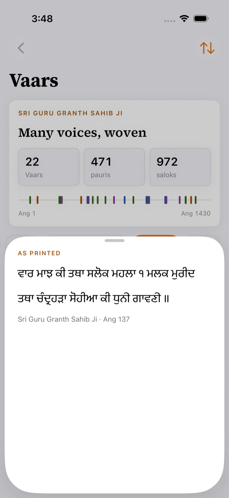
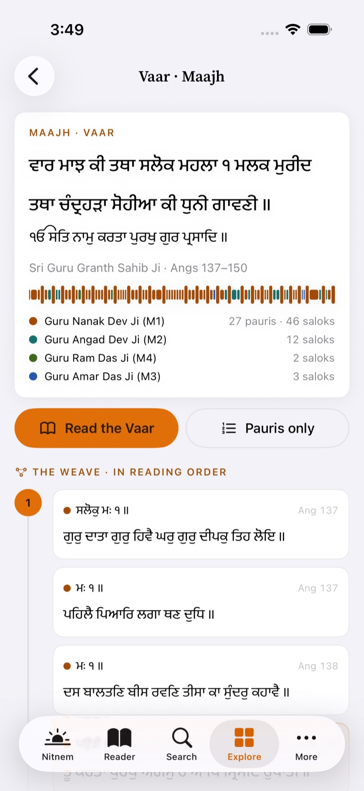
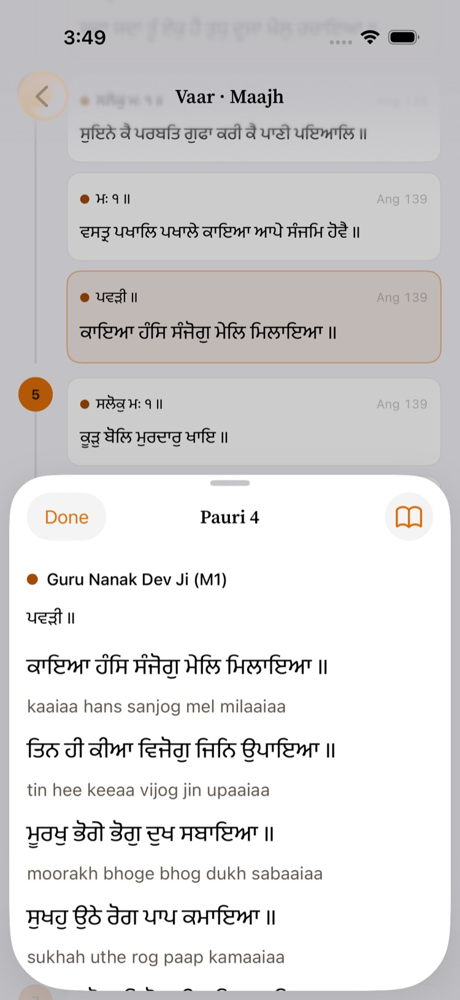
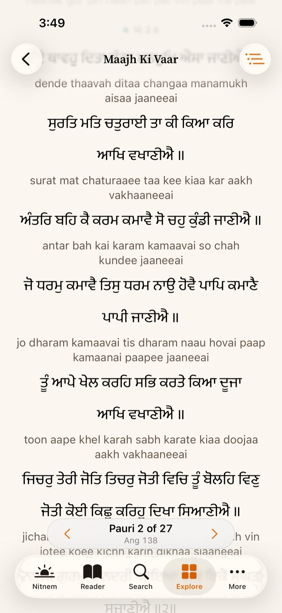
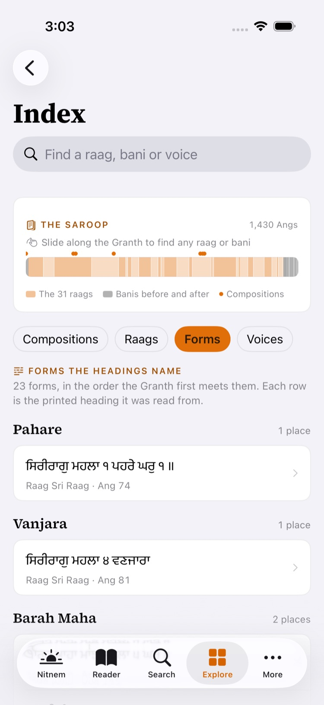
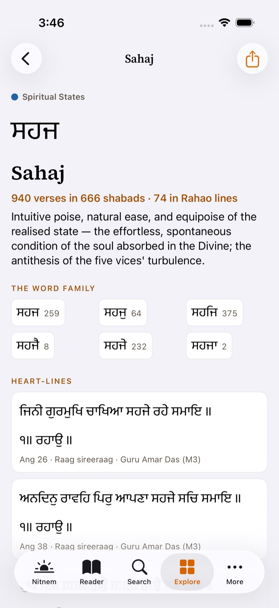
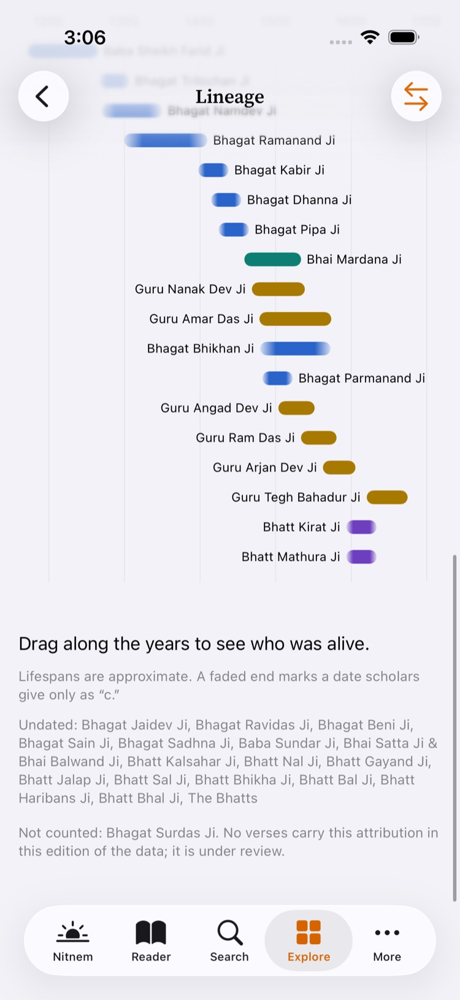
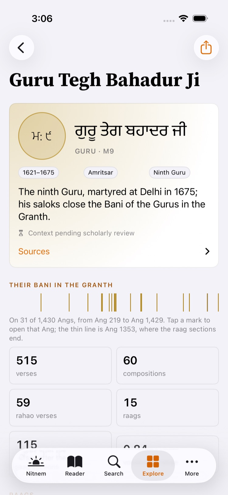
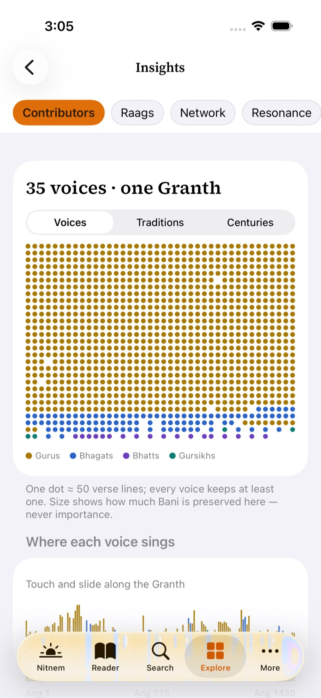
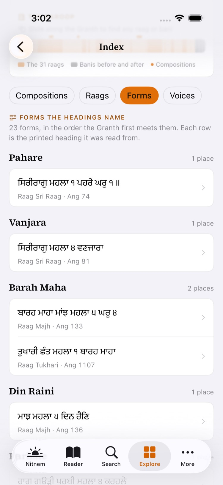

# G3 review pack: the explanatory prose held back in Gurbani Soul 1.4.9

Status: **unreviewed.** An engineer put this pack together so that a Granthi or
Gurbani scholar can see, in one place, every piece of explanation that Gurbani Soul 1.4.9 holds back
for gate G3. The pack is not itself a review. Nothing in it counts as reviewed until the scholar fills
in the decision lines and signs section 10.

**Nothing here changes the app.** Release 1.4.9 shipped with every item below hidden or unchanged.
This pull request adds this document and its screenshots only. It turns on no flag and changes no copy.
Section 9 explains how a decision reaches readers in a later release.

## 1. What this covers and how to read it

**The build.** Gurbani Soul 1.4.9: the tag `v1.4.9` (`f700fb34c4d10a0a645d22ff972482789e4ebb80`) in
`gurbani-soul-ios`. That build includes the roster from `sggs-platform` `v1.4.9` (`f490db57`) and the
dataset `sggs-data` 1.1.0 (`f818b3aa`, database sha256 `e90eab89…`). Every `file:line` below is at
that tag. Every source file this pack quotes is byte-identical at `main` (`595e8774`).

**The scripture.** No Gurmukhi verse is under review here. Every verse that the pack quotes was copied
by a script from the pinned database (`lines.gurmukhi`). None was typed by hand. Each quote carries
its Ang, as "Sri Guru Granth Sahib Ji · Ang N". The pack reviews only the English around the verses,
plus a small number of facts *about* verses: who the app says sang them, and which theme it groups
them under.

**The switches.** Three switches hold the prose back. Three further items have no switch, because
they are data or a way of displaying data.

| Switch | Kind | Holds back | Value in 1.4.9 |
|---|---|---|---|
| `EditorialGate.aboutCopy` (`ios/App/Sources/Data/EditorialGate.swift:7`) | A constant compiled into the app. One switch covers every string it guards. | V-01, T-01 to T-03, L-01 to L-05 | `false` |
| `VoicesFeatures.mapEnabled` (`ios/App/Sources/Components/VoicesMap.swift:8`) | The `sggs_voices_map` user default. It is true only when a reviewer's build is launched with `-sggs_voices_map YES`. | The map, M-01 to M-08 and pins M-P01 to M-P24 | off |
| `review.status` for each voice (`frontend/public/contributors.json`, from `sggs-platform`) | Data, one value per voice. The app shows a voice's `context` only when its status is `approved` (`ios/App/Sources/Data/Contributors.swift:120`). | R-01 to R-36 | `draft` for all 36 |
| *(no switch)* Index form glosses | A draft. The glosses are not in the app at all. | G-01 to G-23 | not in the app |
| *(no switch)* Labelled pauris | Already shown in 1.4.9. | V-02 to V-05 | shown |
| *(no switch)* The ਕਰਮ homograph and the Bhagat attribution findings | Data in `sggs-data`. | T-04, A-01 to A-10 | data as in 1.1.0 |

**The decision line.** Each item ends with one line:

- **Approve**: the item may ship as written.
- **Change**: write the wording, or the fact, you want. An engineer applies it in a later commit and
  records that commit next to your initials in section 10.
- **Reject**: the item must not ship. Where the item is a whole feature (the map, the milestones),
  rejecting it keeps the feature off.

A blank line means "not decided yet". Nothing is switched on for an undecided item. Where a pre-review
note is given, it is the engineer's own concern, offered so that you can agree or disagree with it. It
is not part of the item.

**The rules each item is checked against.** These are the project's own rules, unchanged from the
earlier G3 pack (`docs/review/g3-constellation-v2-and-hukam-of-the-day.md`, rules R1 to R4):

- **R1 Verbatim and cited.** Every quotation carries its Ang.
- **R2 Explanation is labelled.** Explanation is labelled as explanation and kept apart from the quotation.
- **R3 Descriptive, never a ranking of scripture.**
- **R4 Voice.** Reverent, plain and exact.

---

## 2. Vaars

### V-01 · The About line on the ਧੁਨੀ sheet

Where: Explore › Vaars. A Vaar whose heading names a tune shows a ਧੁਨੀ button. Tapping it opens a sheet
headed *As printed*. The sheet shows the ਧੁਨੀ line verbatim with its Ang. In 1.4.9 the sheet shows
nothing else. Screenshot: `screenshots/vaars_dhuni_sheet.jpg`.
Hidden by `EditorialGate.aboutCopy`, `ios/App/Sources/Screens/VaarsScreen.swift:261-265`.

> `About: the heading names the tune (ਧੁਨੀ) the Vaar is to be sung to.`

Question: Is this an accurate and sufficient description of what the ਧੁਨੀ heading means? Is the
label "About:" enough to mark it as explanation (R2)?

Pre-review note: the line puts "ਧੁਨੀ" inside an English sentence. The visible filter label `With ਧੁਨੀ`
(`VaarsScreen.swift:302`) does the same. The 9 ਧੁਨੀ rubrics in the 22 Vaars are shown verbatim from the corpus.

**Decision V-01:** ☐ Approve · ☐ Change (wording: ____________________) · ☐ Reject

### V-02 to V-05 · Four pauris printed with an explicit `ਪਉੜੀ ਮਃ ੫` label

These are **not hidden**. 1.4.9 shows them. They are here because the way the app credits them is a
claim about authorship, and that claim needs your ruling.

**What the app does.** A Vaar's pauris normally take the Vaar's own author (`vaars.pauri_author`). When
the printed label in front of a pauri names a Mahalla (`ਮਃ N` or `ਮਹਲਾ N`), the app instead credits
the pauri to the Guru the label names (`VaarStructure.author(ofLabel:)`,
`ios/Packages/GurbaniSearchKit/Sources/GurbaniSearchKit/VaarText.swift:159-168`, used at line 222).
The credit appears as the voice name and colour on the Vaar's weave, in the unit sheet and in the
Vaar reader (`VaarWeaveScreen.swift:237`, `:288-289`; `VaarReaderScreen.swift:142`, `:159`). Screenshots:
`screenshots/vaar_weave_top.jpg`, `screenshots/vaar_unit_sheet.jpg`, `screenshots/vaar_reader_mid.jpg`.

The 22 Vaars carry 471 pauris. Four of them have a label that names a Mahalla:

##### V-02 · Gauri ki Vaar (Mahalla 4), vaar 3, Angs 300–317, pauri ॥੩੦॥

Label line 14429, Ang 316. The Vaar's own pauri author (`vaars.pauri_author`): `Guru Ram Das Ji (M4)`. The app shows this pauri under **Guru Arjan Dev Ji**, the Guru its label names. Lines 14429–14434:

> ਪਉੜੀ ਮਃ ੫ ॥  
> ਭਗਤ ਜਨਾਂ ਕਾ ਰਾਖਾ ਹਰਿ ਆਪਿ ਹੈ ਕਿਆ ਪਾਪੀ ਕਰੀਐ ॥  
> ਗੁਮਾਨੁ ਕਰਹਿ ਮੂੜ ਗੁਮਾਨੀਆ ਵਿਸੁ ਖਾਧੀ ਮਰੀਐ ॥  
> ਆਇ ਲਗੇ ਨੀ ਦਿਹ ਥੋੜੜੇ ਜਿਉ ਪਕਾ ਖੇਤੁ ਲੁਣੀਐ ॥  
> ਜੇਹੇ ਕਰਮ ਕਮਾਵਦੇ ਤੇਵੇਹੋ ਭਣੀਐ ॥  
> ਜਨ ਨਾਨਕ ਕਾ ਖਸਮੁ ਵਡਾ ਹੈ ਸਭਨਾ ਦਾ ਧਣੀਐ ॥੩੦॥
>
> — Sri Guru Granth Sahib Ji · Ang 316

**Decision V-02:** ☐ Approve (show it under the Guru the label names, as 1.4.9 does) · ☐ Change (show it under: ______________) · ☐ Reject

##### V-03 · Gauri ki Vaar (Mahalla 4), vaar 3, Angs 300–317, pauri ॥੩੧॥

Label line 14448, Ang 316. The Vaar's own pauri author (`vaars.pauri_author`): `Guru Ram Das Ji (M4)`. The app shows this pauri under **Guru Arjan Dev Ji**, the Guru its label names. Lines 14448–14458:

> ਪਉੜੀ ਮਃ ੫ ॥  
> ਨਾਨਕ ਵੀਚਾਰਹਿ ਸੰਤ ਮੁਨਿ ਜਨਾਂ ਚਾਰਿ ਵੇਦ ਕਹੰਦੇ ॥  
> ਭਗਤ ਮੁਖੈ ਤੇ ਬੋਲਦੇ ਸੇ ਵਚਨ ਹੋਵੰਦੇ ॥  
> ਪਰਗਟ ਪਾਹਾਰੈ ਜਾਪਦੇ ਸਭਿ ਲੋਕ ਸੁਣੰਦੇ ॥  
> ਸੁਖੁ ਨ ਪਾਇਨਿ ਮੁਗਧ ਨਰ ਸੰਤ ਨਾਲਿ ਖਹੰਦੇ ॥  
> ਓਇ ਲੋਚਨਿ ਓਨਾ ਗੁਣਾ ਨੋ ਓਇ ਅਹੰਕਾਰਿ ਸੜੰਦੇ ॥  
> ਓਇ ਵੇਚਾਰੇ ਕਿਆ ਕਰਹਿ ਜਾਂ ਭਾਗ ਧੁਰਿ ਮੰਦੇ ॥  
> ਜੋ ਮਾਰੇ ਤਿਨਿ ਪਾਰਬ੍ਰਹਮਿ ਸੇ ਕਿਸੈ ਨ ਸੰਦੇ ॥  
> ਵੈਰੁ ਕਰਨਿ ਨਿਰਵੈਰ ਨਾਲਿ ਧਰਮਿ ਨਿਆਇ ਪਚੰਦੇ ॥  
> ਜੋ ਜੋ ਸੰਤਿ ਸਰਾਪਿਆ ਸੇ ਫਿਰਹਿ ਭਵੰਦੇ ॥  
> ਪੇਡੁ ਮੁੰਢਾਹੂ ਕਟਿਆ ਤਿਸੁ ਡਾਲ ਸੁਕੰਦੇ ॥੩੧॥
>
> — Sri Guru Granth Sahib Ji · Ang 316–317

**Decision V-03:** ☐ Approve (show it under the Guru the label names, as 1.4.9 does) · ☐ Change (show it under: ______________) · ☐ Reject

##### V-04 · Sarang ki Vaar (Mahalla 4), vaar 20, Angs 1237–1251, pauri ॥੩੫॥

Label line 53845, Ang 1251. The Vaar's own pauri author (`vaars.pauri_author`): `Guru Ram Das Ji (M4)`. The app shows this pauri under **Guru Arjan Dev Ji**, the Guru its label names. Lines 53845–53850:

> ਪਉੜੀ ਮਃ ੫ ॥  
> ਸਚੁ ਖਾਣਾ ਸਚੁ ਪੈਨਣਾ ਸਚੁ ਨਾਮੁ ਅਧਾਰੁ ॥  
> ਗੁਰਿ ਪੂਰੈ ਮੇਲਾਇਆ ਪ੍ਰਭੁ ਦੇਵਣਹਾਰੁ ॥  
> ਭਾਗੁ ਪੂਰਾ ਤਿਨ ਜਾਗਿਆ ਜਪਿਆ ਨਿਰੰਕਾਰੁ ॥  
> ਸਾਧੂ ਸੰਗਤਿ ਲਗਿਆ ਤਰਿਆ ਸੰਸਾਰੁ ॥  
> ਨਾਨਕ ਸਿਫਤਿ ਸਲਾਹ ਕਰਿ ਪ੍ਰਭ ਕਾ ਜੈਕਾਰੁ ॥੩੫॥
>
> — Sri Guru Granth Sahib Ji · Ang 1251

**Decision V-04:** ☐ Approve (show it under the Guru the label names, as 1.4.9 does) · ☐ Change (show it under: ______________) · ☐ Reject

##### V-05 · Malar ki Vaar (Mahalla 1), vaar 21, Angs 1278–1291, pauri ॥੨੭॥

Label line 55493, Ang 1291. The Vaar's own pauri author (`vaars.pauri_author`): `Guru Nanak Dev Ji (M1)`. The app shows this pauri under **Guru Arjan Dev Ji**, the Guru its label names. Lines 55493–55501:

> ਪਉੜੀ ਨਵੀ ਮਃ ੫ ॥  
> ਸਭੋ ਵਰਤੈ ਚਲਤੁ ਚਲਤੁ ਵਖਾਣਿਆ ॥  
> ਪਾਰਬ੍ਰਹਮੁ ਪਰਮੇਸਰੁ ਗੁਰਮੁਖਿ ਜਾਣਿਆ ॥  
> ਲਥੇ ਸਭਿ ਵਿਕਾਰ ਸਬਦਿ ਨੀਸਾਣਿਆ ॥  
> ਸਾਧੂ ਸੰਗਿ ਉਧਾਰੁ ਭਏ ਨਿਕਾਣਿਆ ॥  
> ਸਿਮਰਿ ਸਿਮਰਿ ਦਾਤਾਰੁ ਸਭਿ ਰੰਗ ਮਾਣਿਆ ॥  
> ਪਰਗਟੁ ਭਇਆ ਸੰਸਾਰਿ ਮਿਹਰ ਛਾਵਾਣਿਆ ॥  
> ਆਪੇ ਬਖਸਿ ਮਿਲਾਏ ਸਦ ਕੁਰਬਾਣਿਆ ॥  
> ਨਾਨਕ ਲਏ ਮਿਲਾਇ ਖਸਮੈ ਭਾਣਿਆ ॥੨੭॥
>
> — Sri Guru Granth Sahib Ji · Ang 1291

**Decision V-05:** ☐ Approve (show it under the Guru the label names, as 1.4.9 does) · ☐ Change (show it under: ______________) · ☐ Reject

**Related, for the same ruling.** The same Vaar (Gauri ki Vaar, Mahalla 4) prints three earlier
pauris with the bare label `ਪਉੜੀ ੫ ॥`. That label has no `ਮਃ`. The app reads it as naming no one, so
it shows these three pauris under the Vaar's author, **Guru Ram Das Ji**. The very next two pauris
(V-02 and V-03) show under Guru Arjan Dev Ji. In the dataset, the `author` column of every line of
all five pauris says `Guru Arjan Dev Ji (M5)`.

| Label line | Ang | Label, verbatim | Closing verse of that pauri, verbatim |
|---|---|---|---|
| 14375 | 315 | `ਪਉੜੀ ੫ ॥` | `ਅਜਰਾਈਲੁ ਫਰੇਸਤਾ ਤਿਲ ਪੀੜੇ ਘਾਣੀ ॥੨੭॥` (line 14380) |
| 14387 | 315 | `ਪਉੜੀ ੫ ॥` | `ਨਾਨਕ ਤਿਸੁ ਸਰਣਾਗਤੀ ਜੋ ਪੁਰਖੁ ਅਲਖੈ ॥੨੮॥` (line 14392) |
| 14399 | 315 | `ਪਉੜੀ ੫ ॥` | `ਨਾਨਕ ਕਉ ਗੁਰਿ ਬਖਸਿਆ ਨਾਮੈ ਸੰਗਿ ਜੁਟੁ ॥੨੯॥` (line 14404) |

Question: should pauris 27 to 29 (bare `ਪਉੜੀ ੫ ॥`) be shown in the same way as pauris 30 and 31? If
so, under which Guru? An engineer would make that change in `VaarText.swift`. It is a display rule,
and no scripture text changes.

**Decision V-02a (Ang 315, pauris ॥੨੭॥ to ॥੨੯॥):** ☐ Approve (keep under the Vaar's author, as 1.4.9 does) · ☐ Change (show under: ______________) · ☐ Reject

---

## 3. Themes

Where: Explore › Themes › a theme's page (`ThemeChapterScreen`). Screenshots:
`screenshots/theme-page.jpg`, `screenshots/themes-index.jpg`.

### Hidden by `EditorialGate.aboutCopy`

In each string below, `\(name)` stands for the theme's English name (for example *Sehaj*).

#### T-01 · The Rahao note (above *Heart-lines*)

`ios/App/Sources/Screens/ThemeChapterScreen.swift:146-150`

> `Explanation: Rahao (pause) is the line a shabad returns to; it is traditionally read as the shabad's central thought. These Rahao lines carry \(name).`

Question: Is this description of Rahao accurate and acceptably neutral? Is "traditionally read as
the shabad's central thought" a fair statement?

**Decision T-01:** ☐ Approve · ☐ Change (wording: ____________________) · ☐ Reject

#### T-02 · The word-family note (above the matra forms of the theme's words)

`ios/App/Sources/Screens/ThemeChapterScreen.swift:103-106`

> `The forms of its words as they appear in the text. Tap one to narrow this page to it.`

Question: Is it fine to call the inflected forms (for example ਸਹਜ / ਸਹਜਿ / ਸਹਜੇ) "the forms of its words"?

**Decision T-02:** ☐ Approve · ☐ Change (wording: ____________________) · ☐ Reject

#### T-03 · The rate note (under *Raags* and *Voices that carry it at a higher rate*)

`ios/App/Sources/Screens/ThemeChapterScreen.swift:229-233`

> `A rate is the share of that raag's or voice's tagged verses that carry \(name), beside its share across the whole Granth; shown only where the sample is large enough to be reliable.`

Question: Is this explanation clear? Does it avoid reading as a ranking of raags or of the Gurus and
Bhagats (R3)?

Pre-review note: the two headings it explains are **visible** in 1.4.9 (`ThemeChapterScreen.swift:223`,
`:226`). The list drops " Ji" from voice names (`:227`). The earlier pack's question on honorifics
(question 5) applies here too.

**Decision T-03:** ☐ Approve · ☐ Change (wording: ____________________) · ☐ Reject

### T-04 · Data flag: ਕਰਮ in the theme *Karam Nadar* (Divine grace). Please do not change; decide.

This is data, not copy, and it is visible in 1.4.9. The theme `karam_nadar` is matched by these forms,
each with the number of verses it tags: ਕਰਮ 382 · ਕਰਮੁ 94 · ਕਰਮਿ 90 · ਕਰਮਾ 44 · ਕਰਮੈ 3 (of 2,492 verses tagged `karam_nadar`).

*Explanation (the engineer's understanding, which needs your confirmation):* in Gurbani ਕਰਮ can mean
grace, and it can also mean deeds or ritual acts. If so, some verses grouped under "Divine grace" use
the word in the sense of deeds. The grouping changes only which verses appear under the theme. The text
never changes. Examples from the pinned corpus:

> ਤੇਰੇ ਅਨੇਕ ਤੇਰੇ ਅਨੇਕ ਪੜਹਿ ਬਹੁ ਸਿਮ੍ਰਿਤਿ ਸਾਸਤ ਜੀ ਕਰਿ ਕਿਰਿਆ ਖਟੁ ਕਰਮ ਕਰੰਤਾ ॥
>
> — Sri Guru Granth Sahib Ji · Ang 11 (line 490; tagged to `karam_nadar` by: ਕਰਮ)

> ਕੇਤੀਆ ਕਰਮ ਭੂਮੀ ਮੇਰ ਕੇਤੇ ਕੇਤੇ ਧੂ ਉਪਦੇਸ ॥
>
> — Sri Guru Granth Sahib Ji · Ang 7 (line 340; tagged to `karam_nadar` by: ਕਰਮ)

> ਕਰਮ ਖੰਡ ਕੀ ਬਾਣੀ ਜੋਰੁ ॥
>
> — Sri Guru Granth Sahib Ji · Ang 8 (line 354; tagged to `karam_nadar` by: ਕਰਮ)

> ਕਰਮੀ ਆਵੈ ਕਪੜਾ ਨਦਰੀ ਮੋਖੁ ਦੁਆਰੁ ॥
>
> — Sri Guru Granth Sahib Ji · Ang 2 (line 36; tagged to `karam_nadar` by: ਨਦਰੀ)

The theme's stored description (`concepts.description`, owned by `sggs-data`) already says "grace and
personal effort (karam as deed) are both present". 1.4.9 does not show that description on the theme
page.

Options:
- **(a)** keep the theme as it is, and add a short labelled note on the theme page. The note would be
  new copy and would come back to G3;
- **(b)** remove the ਕਰਮ forms from the theme in a future `sggs-data` release. This needs the
  editorial ledger and the usual rebuild gates;
- **(c)** hand-pick which ਕਰਮ verses stay.

**Decision T-04:** ☐ (a) · ☐ (b) · ☐ (c) · ☐ Other: ____________________

### For information: Themes copy that is already visible in 1.4.9

The Themes review sheet of 2026-10-23 also listed these strings. They are **not** behind a switch:
they shipped visible in 1.4.9. They are listed so that you can raise any of them. The wording is the
code as shipped, which differs in places from the sheet. For example, "Shabads steeped in it" became
"Shabads where it fills half the verses".

| # | String as shipped | Where |
|---|---|---|
| T-V1 | `Explore the Granth by idea — each theme gathers every verse that uses its corpus-verified Gurmukhi words, shown verbatim with its Ang.` | `ThemesScreen.swift:79` |
| T-V2 | `A count of verses that carry each theme's words — not a measure of importance.` | `ThemesScreen.swift:94` |
| T-V3 | `A theme is a set of verified Gurmukhi words; a verse carries it when it contains one of them. Sizes differ because some words are everywhere in the Granth and some are rare.` | `ThemesScreen.swift:100` |
| T-V4 | `Shabads where it fills half the verses` · `Shabads of \(SteepedShabad.minLines) or more verses where at least half carry \(name), in reading order.` | `ThemeChapterScreen.swift:165-166` |
| T-V5 | `Raags that carry it at a higher rate` · `Voices that carry it at a higher rate` | `ThemeChapterScreen.swift:223`, `:226` |
| T-V6 | `The themes that share shabads with \(name) more than their size alone would predict.` | `ThemeChapterScreen.swift:257` |
| T-V7 | Theme of the day: `Sri Guru Granth Sahib Ji · Ang \(line.ang)` with ` · a Rahao line` when the verse is a Rahao line | `ThemesScreen.swift:331` |
| T-V8 | Your themes: `Save verses as you read, and this shows the themes they carry. It is worked out on this device; nothing leaves it.` · `Your \(summary.savedCount) saved verses carry` · `Not met yet:` | `YourThemes.swift:80`, `:84`, `:102` |
| T-V9 | The theme's stored description (`concepts.description`, owned by `sggs-data`), shown in full under the counts with no "explanation" label. For example, for Sahaj: `Intuitive poise, natural ease, and equipoise of the realised state — the effortless, spontaneous condition of the soul absorbed in the Divine; the antithesis of the five vices' turbulence.` | `ThemeChapterScreen.swift:93-96` (screenshot `theme-page.jpg`) |

Pre-review note on T-V9: the description is explanation, and it is shown with no label. The
Constellation's theme card shows the same 54 descriptions under **About this theme** with the note
*An editorial note, not scripture.* (earlier G3 pack, section 3a and question 6). The theme page does
not carry that label. This pack changes nothing: it reports the difference for your decision.

**Decision T-V9 (label the description on the theme page as the Constellation does):** ☐ Yes · ☐ No · ☐ Other: ______

Remarks (optional): ______________________________________________

---

## 4. Voices of the Granth (Lineage and Insights)

Where: Explore › Lineage (the River timeline and each voice's page), and Explore › Insights ›
Contributors (the dot field, the ribbon and the map). Screenshots:
`screenshots/lineage-river.jpg`, `screenshots/voice-m9.jpg`, `screenshots/insights_contributors.jpg`.

### Hidden by `EditorialGate.aboutCopy`

#### L-01 · A voice's page, *The heart of each shabad · Rahao*

`ios/App/Sources/Screens/VoicePage.swift:266-269`. It sits above the visible count, "N of their
shabads carry a rahao verse; tap one to read the whole shabad."

> `The rahao verse holds a shabad's centre.`

**Decision L-01:** ☐ Approve · ☐ Change (wording: ____________________) · ☐ Reject

#### L-02 · A voice's page, *How they sign* (shown on a Guru's page)

`ios/App/Sources/Screens/VoicePage.swift:353-358`

> `Every Guru signs the Bani with the name Nanak; the Mahala number in each heading tells the Gurus apart.`

**Decision L-02:** ☐ Approve · ☐ Change (wording: ____________________) · ☐ Reject

#### L-03 · A voice's page, *How they sign* (every voice that is not a Guru)

`ios/App/Sources/Screens/VoicePage.swift:356`

> `This voice signs the Bani with their own name, usually in a shabad's closing verse.`

Pre-review note: this sentence is shown for every voice that is not a Guru. That includes the Bhatts,
Satta and Balwand, and Baba Sundar. The roster records each voice's pen-name and its proving verse in
`chhap` (see the roster pack). Is "their own name" true for all of them?

**Decision L-03:** ☐ Approve · ☐ Change (wording: ____________________) · ☐ Reject

#### L-04 · A voice's page, *In dialogue*

`ios/App/Sources/Screens/VoicePage.swift:405-408`

> `In the salok collections, saloks of the Gurus are set beside saloks of the Bhagats.`

**Decision L-04:** ☐ Approve · ☐ Change (wording: ____________________) · ☐ Reject

#### L-05 · The Granth's milestones on the River timeline

`ios/App/Sources/Screens/VoiceRiverView.swift:21-28`. They are drawn as dashed lines on the timeline
and listed in its legend and its list version. Screenshot: `screenshots/lineage-river.jpg` (shown
without them). The code comment says: "Historical claims without a reviewed source yet."

| # | Year drawn | Label shown | Title shown |
|---|---|---|---|
| L-05a | 1604 | `1604` | `The Adi Granth is compiled` |
| L-05b | 1706 | `c. 1705–06` | `The Damdama Sahib Bir adds Guru Tegh Bahadur Ji's Bani` |
| L-05c | 1708 | `1708` | `Guruship passes to the Granth` |

Question: Are these three facts and their dates correct? Is each worded acceptably? Should a source
be cited for each, as the roster cites a source for each life date?

**Decision L-05a:** ☐ Approve · ☐ Change (wording: ____________________) · ☐ Reject
**Decision L-05b:** ☐ Approve · ☐ Change (wording: ____________________) · ☐ Reject
**Decision L-05c:** ☐ Approve · ☐ Change (wording: ____________________) · ☐ Reject

### The Insights map, hidden by `VoicesFeatures.mapEnabled`

Where: Explore › Insights › Contributors. The map would sit between the dot field and *Where each
voice sings* (`ios/App/Sources/Screens/ContributorsView.swift:95-102`). It is a coastline-only map of
the subcontinent with no modern borders. Each voice appears at one place as a slider moves through the
years 1170 to 1680. Screenshot: `screenshots/insights_contributors.jpg` shows the screen as shipped,
without the map. There is **no screenshot of the map itself**: it is captured only by
`testCaptureVoicesMap` on a simulator, and none was available for this pack (see section 8).

| # | String, verbatim | Where (`VoicesMap.swift` unless noted) |
|---|---|---|
| M-01 | `From Multan to Banaras` (section header) | `ContributorsView.swift:99` |
| M-02 | `By \(year): \(shown) of \(dated) dated voices` | `:142` |
| M-03 | Tapped voice: `\(English name) · \(pin label) · \(era)` (the two values come from the table below) | `:146` |
| M-04 | `Dates uncertain: ` followed by the names of the voices with a pin but no year | `:150` |
| M-05 | `Places are approximate and cited in the roster; years are birth (or death) years, often traditional. Voices without a known place are not mapped. Coastline: Natural Earth.` | `:153` |
| M-06 | VoiceOver, each pin: `\(spoken name), \(pin label), approximate` | `:124` |
| M-07 | VoiceOver, the map: `Map of the subcontinent with the voices of the Granth` | `:131` |
| M-08 | VoiceOver, the slider: `Year`, with the value `\(year), \(n) voices` | `:136-137` |

Question: Is placing each voice at one town and one year acceptable at all? If it is, are the places
and the years below right? "From Multan to Banaras" is the engineer's title. Is it acceptable?

The pins come from the roster's `place` field, and their sources are given in the roster pack. The
scrubber uses the birth year, or the death year when no birth year is known.

| # | Voice | Pin label (shown when tapped) | lat, lon | Year the scrubber uses | Era line (shown when tapped) |
|---|---|---|---|---|---|
| M-P01 | Guru Nanak Dev Ji | Kartarpur, on the Ravi | 32.09, 75.02 | 1469 (born) | Founder · 1469–1539 |
| M-P02 | Guru Angad Dev Ji | Khadur | 31.41, 75.09 | 1504 (born) | Second Guru · 1504–1552 |
| M-P03 | Guru Amar Das Ji | Goindval | 31.37, 75.15 | 1479 (born) | Third Guru · 1479–1574 |
| M-P04 | Guru Ram Das Ji | Amritsar | 31.63, 74.87 | 1534 (born) | Fourth Guru · 1534–1581 |
| M-P05 | Guru Arjan Dev Ji | Amritsar | 31.63, 74.87 | 1563 (born) | Fifth Guru · 1563–1606 |
| M-P06 | Guru Tegh Bahadur Ji | Chakk Nanaki (Anandpur) | 31.24, 76.5 | 1621 (born) | Ninth Guru · 1621–1675 |
| M-P07 | Baba Sheikh Farid Ji | Ajodhan (Pakpattan) | 30.34, 73.39 | 1173 (born) | 12th–13th century |
| M-P08 | Bhagat Jaidev Ji | Kenduli (Birbhum) | 23.64, 87.4 | —  (listed under *Dates uncertain*) | 12th century |
| M-P09 | Bhagat Trilochan Ji | Barsi (one of two traditions) | 18.23, 75.69 | 1267 (born) | 13th–14th century |
| M-P10 | Bhagat Namdev Ji | Pandharpur | 17.68, 75.33 | 1270 (born) | 13th–14th century |
| M-P11 | Bhagat Ramanand Ji | Kashi (Varanasi) | 25.32, 83.01 | 1300 (born) | 14th–15th century |
| M-P12 | Bhagat Kabir Ji | Kashi (Varanasi) | 25.32, 83.01 | 1398 (born) | 15th century |
| M-P13 | Bhagat Ravidas Ji | Varanasi | 25.32, 83.01 | —  (listed under *Dates uncertain*) | 15th century |
| M-P14 | Bhagat Dhanna Ji | Dhuan (Tonk district) | 26.17, 75.79 | 1415 (born) | 15th century |
| M-P15 | Bhagat Pipa Ji | Gagraun | 24.63, 76.19 | 1425 (born) | 15th century |
| M-P16 | Bhagat Sadhna Ji | Sehwan (Sindh) | 26.42, 67.86 | —  (listed under *Dates uncertain*) | 13th–14th century |
| M-P17 | Bhagat Parmanand Ji | Barsi (Sholapur district) | 18.23, 75.69 | 1483 (born) | 15th–16th century |
| M-P18 | Bhagat Surdas Ji | Banaras (Varanasi) | 25.32, 83.01 | 1529 (born) | 16th century |
| M-P19 | Bhai Mardana Ji | Talwandi (Nankana Sahib) | 31.45, 73.71 | 1459 (born) | 15th–16th century |
| M-P20 | Baba Sundar Ji | Goindval (Guru Amar Das's seat) | 31.37, 75.15 | —  (listed under *Dates uncertain*) | 16th century |
| M-P21 | Bhai Satta Ji & Bhai Balwand Ji | Lahore (buried on the Ravi) | 31.55, 74.34 | —  (listed under *Dates uncertain*) | 16th–17th century |
| M-P22 | Bhatt Mathura Ji | Amritsar (fell there in 1634) | 31.63, 74.87 | 1634 (died) | Court bard · late 16th c. |
| M-P23 | Bhatt Jalap Ji | Goindval | 31.37, 75.15 | —  (listed under *Dates uncertain*) | Court bard · late 16th c. |
| M-P24 | Bhatt Bhikha Ji | Sultanpur Lodhi | 31.21, 75.2 | —  (listed under *Dates uncertain*) | Court bard · late 16th c. |

Not on the map (no `place` in the roster): Bhagat Beni Ji, Bhagat Bhikhan Ji, Bhagat Sain Ji, Bhatt Kalsahar Ji, Bhatt Nal Ji, Bhatt Kirat Ji, Bhatt Gayand Ji, Bhatt Sal Ji, Bhatt Bal Ji, Bhatt Haribans Ji, Bhatt Bhal Ji, The Bhatts.

**Decision M-01 to M-08 (the map's copy):** ☐ Approve · ☐ Change (which, and wording: ______________) · ☐ Reject the map
**Decision M-P01 to M-P24 (the pins):** ☐ Approve all · ☐ Approve except: ______________ (corrections in the roster) · ☐ Reject

### R-01 to R-36 · The 36-voice roster: `context` and `review.status`

**What is hidden.** Each voice's page shows a short life paragraph. In 1.4.9 that paragraph is the
one-line `blurb`, which was already in the app before roster v2. Below it is the label
`Context pending scholarly review` (`VoicePage.swift:150-153`). The longer roster v2 `context` below
replaces the blurb only when that voice's `review.status` is `approved`
(`Contributor.lifeText` / `reviewedContext`, `Contributors.swift:116-123`). The life dates, birthplace
and tradition chips are shown already. They come from the same roster.

**The full evidence is in the roster pack.** The platform's
[`docs/review/lineage-roster-v2.md`](https://github.com/Algorythmos-AI/sggs-platform/blob/v1.4.9/docs/review/lineage-roster-v2.md)
gives every field with its source: dates, birthplace, map pin, pen-name with its proving verse, and
notable Banis. It also asks six questions of its own:

- the number of Bhatts;
- Bhai Mardana;
- Bhagat Surdas;
- Raagmala;
- Japji's author;
- the Gurmukhi forms of the names.

Please answer those six questions there, or in the remarks at the end of this section. This section
quotes only the hidden `context` of each voice, its review status, and any review notes or disputes
that the roster records. The text comes from the roster as vendored at `sggs-platform` `v1.4.9`. Its
sha256 is `cb8257ec…`, which is the same file the platform's pack is generated from.

Pre-review note (R1): a few contexts quote a Gurmukhi line with a short reference, for example
"(Sarang, Ang 1253)" in R-21. They do not use the full citation form "Sri Guru Granth Sahib Ji · Ang N".
Every such line was checked: each one is verbatim in the corpus. If you want the full citation
form, mark **Change** on the item.

#### The Gurus (6)

##### R-01 · Guru Nanak Dev Ji

Corpus name `Guru Nanak Dev Ji (M1)` · `review.status` = **draft** · reviewer `null` · date `null`

> Guru Nanak was born on 15 April 1469 at Rai Bhoi ki Talwandi, now Nankana Sahib. After years of travel he settled around 1521 at Kartarpur, where he joined devotion to God with the life of a householder. Before his death on 7 September 1539 he installed Bhai Lahina, whom he renamed Angad, as his successor.

**Decision R-01:** ☐ Approve · ☐ Change (wording: ____________________) · ☐ Reject

##### R-02 · Guru Angad Dev Ji

Corpus name `Guru Angad Dev Ji (M2)` · `review.status` = **draft** · reviewer `null` · date `null`

> Guru Angad was born Lahina on 31 March 1504 at Matte di Sarai, now Sarai Naga. Guru Nanak named him his successor. He passed away at Khadur on 29 March 1552, handing the succession to Guru Amar Das.

**Decision R-02:** ☐ Approve · ☐ Change (wording: ____________________) · ☐ Reject

##### R-03 · Guru Amar Das Ji

Corpus name `Guru Amar Das Ji (M3)` · `review.status` = **draft** · reviewer `null` · date `null`

> Guru Amar Das was born on 5 May 1479 at Basarke and became Guru in 1552, after Guru Angad. Goindval, a settlement he founded at Guru Angad's bidding, was his seat. Before his death on 1 September 1574 he chose Bhai Jetha, his son-in-law, as his successor, Guru Ram Das.

**Decision R-03:** ☐ Approve · ☐ Change (wording: ____________________) · ☐ Reject

##### R-04 · Guru Ram Das Ji

Corpus name `Guru Ram Das Ji (M4)` · `review.status` = **draft** · reviewer `null` · date `null`

> Guru Ram Das was born Jetha on 24 September 1534 in Chuna Mandi, Lahore, and lived at Goindval near Guru Amar Das, who chose him as successor. He founded the settlement that became Amritsar, and he died at Goindval on 1 September 1581.

**Decision R-04:** ☐ Approve · ☐ Change (wording: ____________________) · ☐ Reject

##### R-05 · Guru Arjan Dev Ji

Corpus name `Guru Arjan Dev Ji (M5)` · `review.status` = **draft** · reviewer `null` · date `null`

> Guru Arjan was born on 15 April 1563 at Goindval, the son of Guru Ram Das and Bibi Bhani. He compiled the Adi Granth, installed in the Harimandar on 16 August 1604; over a third of it is his own Bani. He was the first martyr of the Sikh faith, at Lahore on 30 May 1606.

**Decision R-05:** ☐ Approve · ☐ Change (wording: ____________________) · ☐ Reject

##### R-06 · Guru Tegh Bahadur Ji

Corpus name `Guru Tegh Bahadur Ji (M9)` · `review.status` = **draft** · reviewer `null` · date `null`

> Guru Tegh Bahadur, youngest son of Guru Hargobind, was born at Amritsar on 1 April 1621. He founded Chakk Nanaki, later Anandpur, naming it after his mother. He was beheaded in public in Chandni Chowk, Delhi, on 11 November 1675, having named his son Gobind Das as his successor.

**Decision R-06:** ☐ Approve · ☐ Change (wording: ____________________) · ☐ Reject

#### The Bhagats (15)

##### R-07 · Baba Sheikh Farid Ji

Corpus name `Sheikh Farid Ji` · `review.status` = **draft** · reviewer `null` · date `null`

> Shaikh Farid was born in AD 1173 (569 AH) at Kothewal, near Multan, and died in 1265. A Sufi of the Chishti order, he set up a centre at Hansi and later at Ajodhan, now Pakpattan. He is known as the first recorded poet of the Punjabi language.

**Decision R-07:** ☐ Approve · ☐ Change (wording: ____________________) · ☐ Reject

##### R-08 · Bhagat Jaidev Ji

Corpus name `Bhagat Jaidev Ji` · `review.status` = **draft** · reviewer `null` · date `null`

> Jaidev is chiefly known as the author of the Gita Govinda. He was born at Kindu Bilva, identified with Kenduli in Bengal or Kenduli-Sasan near Puri, and died in his birth village. Two of his hymns are in the Granth.

- *Where sources differ* (roster `disputed`): His birthplace is disputed: Kenduli in Bengal or Kenduli-Sasan near Puri in Odisha.

**Decision R-08:** ☐ Approve · ☐ Change (wording: ____________________) · ☐ Reject

##### R-09 · Bhagat Trilochan Ji

Corpus name `Bhagat Trilochan Ji` · `review.status` = **draft** · reviewer `null` · date `null`

> Trilochan was a Maharashtrian saint-poet, said to have been born in 1267 to a Vaishya family. Four of his hymns are in the Granth, in Siri, Gujri and Dhanasri. Two saloks among Kabir's present a dialogue between him and Namdev.

- Review note in the roster: Inside the Saloks of Bhagat Kabir (Angs 1364–1377), saloks 212–213 (Ang 1375–1376) are a dialogue signed by Namdev and Trilochan, salok 241 is signed by Namdev and salok 242 by Ravidas (Ang 1377). Today's corpus credits them to Guru Arjan (a header bleed); sggs-data 1.1.0 credits them to Bhagat Kabir Ji as part of his collection and flags them for review. Scholar to rule whether each is shown under Kabir or under the voice that signs it.
- *Where sources differ* (roster `disputed`): Scholars disagree on his birthplace: Barsi (Sholapur district) or Uttar Pradesh.

**Decision R-09:** ☐ Approve · ☐ Change (wording: ____________________) · ☐ Reject

##### R-10 · Bhagat Namdev Ji

Corpus name `Bhagat Namdev Ji` · `review.status` = **draft** · reviewer `null` · date `null`

> Namdev was born in 1270 at Narasi-Vamani in Maharashtra, to a tailor's family, and turned to bhakti under Jnanadeva. He is said to have lived for over twenty years at Ghuman in the Punjab, and later settled at Pandharpur. Sixty-one of his hymns are in the Granth.

- Review note in the roster: Inside the Saloks of Bhagat Kabir (Angs 1364–1377), saloks 212–213 (Ang 1375–1376) are a dialogue signed by Namdev and Trilochan, salok 241 is signed by Namdev and salok 242 by Ravidas (Ang 1377). Today's corpus credits them to Guru Arjan (a header bleed); sggs-data 1.1.0 credits them to Bhagat Kabir Ji as part of his collection and flags them for review. Scholar to rule whether each is shown under Kabir or under the voice that signs it.

**Decision R-10:** ☐ Approve · ☐ Change (wording: ____________________) · ☐ Reject

##### R-11 · Bhagat Ramanand Ji

Corpus name `Bhagat Ramanand Ji` · `review.status` = **draft** · reviewer `null` · date `null`

> Ramanand was born at Prayag and taught at Kashi, where he founded the Ramanandi sampradaya. Tradition names Kabir, Ravidas, Sain and Dhanna among his disciples, though the dates make this impossible for all of them. His one hymn in the Granth (Basant, Ang 1195) rejects idol-worship.

**Decision R-11:** ☐ Approve · ☐ Change (wording: ____________________) · ☐ Reject

##### R-12 · Bhagat Kabir Ji

Corpus name `Bhagat Kabir Ji` · `review.status` = **draft** · reviewer `null` · date `null`

> Kabir's life centred on Kashi (Banaras), where he worked as a weaver. Of all the Bhagats his contribution to the Granth is the largest: 227 padas in 17 raags and 237 saloks. He spent his last days at Magahar rather than Banaras.

- Review note in the roster: Inside the Saloks of Bhagat Kabir (Angs 1364–1377), saloks 212–213 (Ang 1375–1376) are a dialogue signed by Namdev and Trilochan, salok 241 is signed by Namdev and salok 242 by Ravidas (Ang 1377). Today's corpus credits them to Guru Arjan (a header bleed); sggs-data 1.1.0 credits them to Bhagat Kabir Ji as part of his collection and flags them for review. Scholar to rule whether each is shown under Kabir or under the voice that signs it.

**Decision R-12:** ☐ Approve · ☐ Change (wording: ____________________) · ☐ Reject

##### R-13 · Bhagat Ravidas Ji

Corpus name `Bhagat Ravidas Ji` · `review.status` = **draft** · reviewer `null` · date `null`

> Ravidas was born near Varanasi to a family of leather-workers and followed the family trade. He came to reject idol-worship and distinctions of caste, and Mirabai was among his followers. Forty of his hymns are in the Granth.

- Review note in the roster: Inside the Saloks of Bhagat Kabir (Angs 1364–1377), saloks 212–213 (Ang 1375–1376) are a dialogue signed by Namdev and Trilochan, salok 241 is signed by Namdev and salok 242 by Ravidas (Ang 1377). Today's corpus credits them to Guru Arjan (a header bleed); sggs-data 1.1.0 credits them to Bhagat Kabir Ji as part of his collection and flags them for review. Scholar to rule whether each is shown under Kabir or under the voice that signs it.

**Decision R-13:** ☐ Approve · ☐ Change (wording: ____________________) · ☐ Reject

##### R-14 · Bhagat Beni Ji

Corpus name `Bhagat Beni Ji` · `review.status` = **draft** · reviewer `null` · date `null`

> Very little is known of Beni's life except his devotion to prayer and meditation; Bhai Gurdas refers to it. Three of his hymns are in the Granth, in Siri, Ramkali and Prabhati. Guru Arjan directed that the Siri hymn be sung in the tune of Guru Nanak's Pahire.

**Decision R-14:** ☐ Approve · ☐ Change (wording: ____________________) · ☐ Reject

##### R-15 · Bhagat Bhikhan Ji

Corpus name `Bhagat Bhikhan Ji` · `review.status` = **draft** · reviewer `null` · date `null`

> Bhakta Bhikhan was a devotee in the tradition of Ravidas and Dhanna; he is distinct from a Sufi of the same name and time. His two hymns in the Granth call the Name of Hari the cure for all the ills of the world.

**Decision R-15:** ☐ Approve · ☐ Change (wording: ____________________) · ☐ Reject

##### R-16 · Bhagat Dhanna Ji

Corpus name `Bhagat Dhanna Ji` · `review.status` = **draft** · reviewer `null` · date `null`

> Dhanna was born in the village of Dhuan in Tonk district, Rajasthan, the son of a farmer. In a hymn in Asa he tells how the examples of Namdev, Kabir, Ravidas and Sain drew him to God. He turned from worshipping idols to the Formless One, and three of his hymns are in the Granth.

- Review note in the roster: Birthplace: the EoS names Dhuan (Tonk district). Discovery sources also name Dhuan Kalan and Chauru; no tier-2 source for either was found. Scholar to rule before any variant is shown.

**Decision R-16:** ☐ Approve · ☐ Change (wording: ____________________) · ☐ Reject

##### R-17 · Bhagat Sain Ji

Corpus name `Bhagat Sain Ji` · `review.status` = **draft** · reviewer `null` · date `null`

> All accounts agree that Sain was a barber. Bhai Gurdas makes him a disciple of Ramanand. Guru Arjan names him as a bhakta of rare devotion (Ang 487), and Ravidas ranks him with Namdev, Kabir, Trilochan and Sadhna (Ang 1106). His one hymn (Dhanasri, Ang 695) teaches that singing the Lord's praise and meditating on His Name are the highest worship.

- *Where sources differ* (roster `disputed`): Where he served is disputed: one tradition places him at the court of Rewa (Bandhavgarh) in Central India, another at Bidar in the South. No birthplace is given.

**Decision R-17:** ☐ Approve · ☐ Change (wording: ____________________) · ☐ Reject

##### R-18 · Bhagat Pipa Ji

Corpus name `Bhagat Pipa Ji` · `review.status` = **draft** · reviewer `null` · date `null`

> Pipa was a prince, born at Gagraun about 1425, who renounced his throne after initiation by Ramanand at Kashi. He later lived at Dwarka and gave up idol-worship. His one hymn in the Granth (Dhanasri, Ang 695) finds the Divine within the body.

**Decision R-18:** ☐ Approve · ☐ Change (wording: ____________________) · ☐ Reject

##### R-19 · Bhagat Sadhna Ji

Corpus name `Bhagat Sadhna Ji` · `review.status` = **draft** · reviewer `null` · date `null`

> Sadhna lived by selling meat and won spiritual eminence through devotion. He is believed to have been born at Sehwan in Sindh and was cremated at Sirhind, where a tomb honours him. His only hymn, in Bilaval (Ang 858), asks the Lord to save the honour of His servant.

**Decision R-19:** ☐ Approve · ☐ Change (wording: ____________________) · ☐ Reject

##### R-20 · Bhagat Parmanand Ji

Corpus name `Bhagat Parmanand Ji` · `review.status` = **draft** · reviewer `null` · date `null`

> Parmanand was a Maharashtrian saint-poet, born probably in 1483, who is believed to have lived at Barsi, north of Pandharpur. He wrote under the pen-name Sarang. His one hymn in the Granth (Sarang, Ang 1253) faults reading the scriptures as ritual when it does not lead to serving others.

**Decision R-20:** ☐ Approve · ☐ Change (wording: ____________________) · ☐ Reject

##### R-21 · Bhagat Surdas Ji

Corpus name `Bhagat Surdas Ji` · `review.status` = **draft** · reviewer `null` · date `null`

> Surdas, born Madan Mohan, is said to have been born in 1529 into a Brahmin family. He served Akbar as governor of Sandila, renounced the world, and died at Banaras. The Granth keeps one line of his, "ਛਾਡਿ ਮਨ ਹਰਿ ਬਿਮੁਖਨ ਕੋ ਸੰਗੁ" (Sarang, Ang 1253). The shabad after it, headed "ਸਾਰੰਗ ਮਹਲਾ ੫ ਸੂਰਦਾਸ", is Guru Arjan's, written in response.

- *Where sources differ* (roster `disputed`): Only one line is his, and it carries no pen-name. The EoS and Sahib Singh agree that the following shabad is Guru Arjan's, though it names Surdas where the Gurus usually sign ਨਾਨਕ. This Surdas is distinct from the blind poet of the Sur Sagar; Sahib Singh notes that some scholars hold there were two Surdases.
- Roster `attribution_note`: The corpus files his single line (Ang 1253, ਛਾਡਿ ਮਨ ਹਰਿ ਬਿਮੁਖਨ ਕੋ ਸੰਗੁ) under Namdev; no heading or signature is printed with it, so the attribution is with a scholar for review.

**Decision R-21:** ☐ Approve · ☐ Change (wording: ____________________) · ☐ Reject

#### Gursikhs (3)

##### R-22 · Bhai Mardana Ji

Corpus name `Bhai Mardana` · `review.status` = **draft** · reviewer `null` · date `null`

> Mardana was born in 1459 at Talwandi Rai Bhoe to a Mirasi family of hereditary minstrels. He grew up with Guru Nanak, was ten years his senior, and played the rabab as the Guru sang on all his travels. He died at Kartarpur in 1534.

- *Where sources differ* (roster `disputed`): Scholars dispute the attribution. The EoS holds that one salok at Ang 553 is Mardana's and two are Guru Nanak's addressed to him. Sahib Singh (Darpan, Ang 553) holds that all three are Guru Nanak's, because the lines sign ਨਾਨਕਾ/ਨਾਨਕ, which Mardana could not use. Kept in the roster and flagged for the scholar.

**Decision R-22:** ☐ Approve · ☐ Change (wording: ____________________) · ☐ Reject

##### R-23 · Baba Sundar Ji

Corpus name `Baba Sundar Ji` · `review.status` = **draft** · reviewer `null` · date `null`

> Sundar was the great-grandson of Guru Amar Das: his father was Anand Das, son of Baba Mohri. His six-stanza Ramkali Sadu tells of Guru Amar Das's last counsel, not to mourn him, and of his appointing Ram Das as successor. The Sadu is commonly read when a reading of the Granth concludes as part of the obsequies.

**Decision R-23:** ☐ Approve · ☐ Change (wording: ____________________) · ☐ Reject

##### R-24 · Bhai Satta Ji & Bhai Balwand Ji

Corpus name `Satta & Balwand` · `review.status` = **draft** · reviewer `null` · date `null`

> Rai Balwand and Satta, said to be brothers, were Muslim Mirasi minstrels who played the rabab for Guru Arjan. Their Ramkali ki Vaar, known as Tikke di Vaar, sees all the Gurus as sharing one light. Both died at Lahore in the time of Guru Hargobind and were buried on the bank of the Ravi.

**Decision R-24:** ☐ Approve · ☐ Change (wording: ____________________) · ☐ Reject

#### The Bhatts (12)

##### R-25 · Bhatt Kalsahar Ji

Corpus name `Bhatt Kalsahar (ਭਟ)` · `review.status` = **draft** · reviewer `null` · date `null`

> Kalh, also called Kalsahar or Kal Thakur, was a son of Bhatt Bhikha and is reckoned the most learned of the Bhatts. His Swaiyye, the most of any Bhatt, praise all five Gurus, Guru Nanak to Guru Arjan.

- *Where sources differ* (roster `disputed`): How many Bhatts there are is disputed: Sahib Singh and Teja Singh count 11; Santokh Singh and Bhai Vir Singh count 17; Kartar Singh Dakha counts 19. The roster follows the corpus's 11 names.

**Decision R-25:** ☐ Approve · ☐ Change (wording: ____________________) · ☐ Reject

##### R-26 · Bhatt Nal Ji

Corpus name `Bhatt Nal (ਭਟ)` · `review.status` = **draft** · reviewer `null` · date `null`

> Nalh's Swaiyye are all in praise of Guru Ram Das.

- *Where sources differ* (roster `disputed`): How many Bhatts there are is disputed: Sahib Singh and Teja Singh count 11; Santokh Singh and Bhai Vir Singh count 17; Kartar Singh Dakha counts 19. The roster follows the corpus's 11 names.

**Decision R-26:** ☐ Approve · ☐ Change (wording: ____________________) · ☐ Reject

##### R-27 · Bhatt Mathura Ji

Corpus name `Bhatt Mathura (ਭਟ)` · `review.status` = **draft** · reviewer `null` · date `null`

> Mathura, a son of Bhatt Bhikha, sang the praise of Guru Ram Das and Guru Arjan. Trained in arms in Guru Hargobind's time, he fell in the battle of Amritsar in 1634.

- *Where sources differ* (roster `disputed`): How many Bhatts there are is disputed: Sahib Singh and Teja Singh count 11; Santokh Singh and Bhai Vir Singh count 17; Kartar Singh Dakha counts 19. The roster follows the corpus's 11 names.

**Decision R-27:** ☐ Approve · ☐ Change (wording: ____________________) · ☐ Reject

##### R-28 · Bhatt Kirat Ji

Corpus name `Bhatt Kirat (ਭਟ)` · `review.status` = **draft** · reviewer `null` · date `null`

> Kirat, a son of Bhatt Bhikha, wrote Swaiyye in praise of Guru Amar Das and Guru Ram Das.

- *Where sources differ* (roster `disputed`): How many Bhatts there are is disputed: Sahib Singh and Teja Singh count 11; Santokh Singh and Bhai Vir Singh count 17; Kartar Singh Dakha counts 19. The roster follows the corpus's 11 names.

**Decision R-28:** ☐ Approve · ☐ Change (wording: ____________________) · ☐ Reject

##### R-29 · Bhatt Gayand Ji

Corpus name `Bhatt Gayand (ਭਟ)` · `review.status` = **draft** · reviewer `null` · date `null`

> Gayand's Swaiyye glorify Guru Ram Das.

- *Where sources differ* (roster `disputed`): How many Bhatts there are is disputed: Sahib Singh and Teja Singh count 11; Santokh Singh and Bhai Vir Singh count 17; Kartar Singh Dakha counts 19. The roster follows the corpus's 11 names.

**Decision R-29:** ☐ Approve · ☐ Change (wording: ____________________) · ☐ Reject

##### R-30 · Bhatt Jalap Ji

Corpus name `Bhatt Jalap (ਭਟ)` · `review.status` = **draft** · reviewer `null` · date `null`

> Jalap, a son of Bhatt Bhikha, moved to Goindval with his father. His Swaiyye are in praise of Guru Amar Das.

- *Where sources differ* (roster `disputed`): How many Bhatts there are is disputed: Sahib Singh and Teja Singh count 11; Santokh Singh and Bhai Vir Singh count 17; Kartar Singh Dakha counts 19. The roster follows the corpus's 11 names.

**Decision R-30:** ☐ Approve · ☐ Change (wording: ____________________) · ☐ Reject

##### R-31 · Bhatt Sal Ji

Corpus name `Bhatt Sal (ਭਟ)` · `review.status` = **draft** · reviewer `null` · date `null`

> Salh, a son of Sekha (brother of Rayya, Bhikha's father), wrote Swaiyye on the pre-eminence of Guru Amar Das and Guru Ram Das.

- *Where sources differ* (roster `disputed`): How many Bhatts there are is disputed: Sahib Singh and Teja Singh count 11; Santokh Singh and Bhai Vir Singh count 17; Kartar Singh Dakha counts 19. The roster follows the corpus's 11 names.

**Decision R-31:** ☐ Approve · ☐ Change (wording: ____________________) · ☐ Reject

##### R-32 · Bhatt Bhikha Ji

Corpus name `Bhatt Bhikha (ਭਟ)` · `review.status` = **draft** · reviewer `null` · date `null`

> Bhikha, son of Rayya, was a Brahmin bard of Sultanpur Lodhi who received initiation from Guru Amar Das. He lived until Guru Arjan's time and introduced to him sixteen other bards; his Swaiyye praise Guru Amar Das.

- *Where sources differ* (roster `disputed`): How many Bhatts there are is disputed: Sahib Singh and Teja Singh count 11; Santokh Singh and Bhai Vir Singh count 17; Kartar Singh Dakha counts 19. The roster follows the corpus's 11 names.

**Decision R-32:** ☐ Approve · ☐ Change (wording: ____________________) · ☐ Reject

##### R-33 · Bhatt Bal Ji

Corpus name `Bhatt Bal (ਭਟ)` · `review.status` = **draft** · reviewer `null` · date `null`

> Balh, son of Tokha (a brother of Rayya), wrote Swaiyye on the spiritual oneness of the Gurus, in the set praising Guru Ram Das.

- *Where sources differ* (roster `disputed`): How many Bhatts there are is disputed: Sahib Singh and Teja Singh count 11; Santokh Singh and Bhai Vir Singh count 17; Kartar Singh Dakha counts 19. The roster follows the corpus's 11 names.

**Decision R-33:** ☐ Approve · ☐ Change (wording: ____________________) · ☐ Reject

##### R-34 · Bhatt Haribans Ji

Corpus name `Bhatt Haribans (ਭਟ)` · `review.status` = **draft** · reviewer `null` · date `null`

> Haribans, eldest son of Gokha (a brother of Rayya), wrote two Swaiyye, both in praise of Guru Arjan.

- *Where sources differ* (roster `disputed`): How many Bhatts there are is disputed: Sahib Singh and Teja Singh count 11; Santokh Singh and Bhai Vir Singh count 17; Kartar Singh Dakha counts 19. The roster follows the corpus's 11 names.

**Decision R-34:** ☐ Approve · ☐ Change (wording: ____________________) · ☐ Reject

##### R-35 · Bhatt Bhal Ji

Corpus name `Bhatt Bhal (ਭਟ)` · `review.status` = **draft** · reviewer `null` · date `null`

> Bhalh, a son of Sekha, wrote one Swaiyya, in praise of Guru Amar Das.

- *Where sources differ* (roster `disputed`): How many Bhatts there are is disputed: Sahib Singh and Teja Singh count 11; Santokh Singh and Bhai Vir Singh count 17; Kartar Singh Dakha counts 19. The roster follows the corpus's 11 names.

**Decision R-35:** ☐ Approve · ☐ Change (wording: ____________________) · ☐ Reject

##### R-36 · The Bhatts

Corpus name `The Bhatts (ਭਟ)` · `review.status` = **draft** · reviewer `null` · date `null`

> The Bhatts were bards of Brahmin families from the banks of the Sarasvati; some had settled at Sultanpur Lodhi. Their Swaiyye (Angs 1389–1409) praise the Gurus not as individuals but as one light passing from body to body. This entry holds the Swaiyye headers and the lines the corpus does not credit to a named Bhatt.

- *Where sources differ* (roster `disputed`): How many Bhatts there are is disputed: Sahib Singh and Teja Singh count 11; Santokh Singh and Bhai Vir Singh count 17; Kartar Singh Dakha counts 19. The roster follows the corpus's 11 names.

**Decision R-36:** ☐ Approve · ☐ Change (wording: ____________________) · ☐ Reject

Remarks on the roster pack's six questions: ______________________________________________

---

## 5. Index › Forms: the glosses

Where: Explore › Index › Forms (Index 2.0). Screenshot: `screenshots/index_forms.jpg`. The tab lists
the 23 poetic forms that the printed headings name. Each row shows the form's name, the verbatim
heading, the raag and the Ang. **What a form means is not shown anywhere in 1.4.9.** No switch is
involved: the glosses are not in the app at all. They wait in `docs/ios/index-forms-glosses-review.md`,
which records an engineer's confidence for each. Every gloss below is copied verbatim from that file.

| # | Form (key) | First at | Draft literal gloss | Engineer's confidence | Decision |
|---|---|---|---|---|---|
| G-01 | Pahare (`pahare`) | Sri Raag, Ang 74 | "watches": the watches of the night as the stages of a life | likely | ☐ Approve · ☐ Change: ______ · ☐ Reject |
| G-02 | Vanjara (`vanjara`) | Sri Raag, Ang 81 | "the trader" | likely | ☐ Approve · ☐ Change: ______ · ☐ Reject |
| G-03 | Barah Maha (`barah_maha`) | Majh, Ang 133; Tukhari, Ang 1107 | "twelve months" | high | ☐ Approve · ☐ Change: ______ · ☐ Reject |
| G-04 | Din Raini (`din_raini`) | Majh, Ang 136 | "day and night" | high | ☐ Approve · ☐ Change: ______ · ☐ Reject |
| G-05 | Karhale (`karhale`) | Gauri, Ang 234 | "camels" (the restless mind as a camel) | likely | ☐ Approve · ☐ Change: ______ · ☐ Reject |
| G-06 | Bavan Akhri (`bavan_akhri`) | Gauri, Ang 250; Gauri (Kabir), Ang 340 | "fifty-two letters" | high | ☐ Approve · ☐ Change: ______ · ☐ Reject |
| G-07 | Thitti (`thitti`) | Gauri, Ang 296; Gauri (Kabir), Ang 343; Bilaval, Ang 838 | "lunar days" | high | ☐ Approve · ☐ Change: ______ · ☐ Reject |
| G-08 | Dakhne (`dakhne`) | Gauri, Ang 322; Maru, Ang 1094 | "of the south"? (dialect/metre); **needs a scholar** | uncertain | ☐ Approve · ☐ Change: ______ · ☐ Reject |
| G-09 | Birhare (`birhare`) | Asa, Ang 431 | "songs of separation" | likely | ☐ Approve · ☐ Change: ______ · ☐ Reject |
| G-10 | Patti (`patti`) | Asa, Ang 432 and 434 | "the writing tablet" (an alphabet acrostic) | likely | ☐ Approve · ☐ Change: ______ · ☐ Reject |
| G-11 | Ghorian (`ghorian`) | Vadhans, Ang 575 | "mares" (wedding songs) | likely | ☐ Approve · ☐ Change: ______ · ☐ Reject |
| G-12 | Alahunian (`alahunian`) | Vadhans, Ang 578 | "dirges" (songs of mourning) | likely | ☐ Approve · ☐ Change: ______ · ☐ Reject |
| G-13 | Kuchaji (`kuchaji`) | Suhi, Ang 762 | "the unrefined bride" | likely | ☐ Approve · ☐ Change: ______ · ☐ Reject |
| G-14 | Suchaji (`suchaji`) | Suhi, Ang 762 | "the refined bride" | likely | ☐ Approve · ☐ Change: ______ · ☐ Reject |
| G-15 | Gunvanti (`gunvanti`) | Suhi, Ang 763 | "the virtuous bride" | likely | ☐ Approve · ☐ Change: ______ · ☐ Reject |
| G-16 | Sadd (`sadd`) | Ramkali, Ang 923 | "the call" | likely | ☐ Approve · ☐ Change: ______ · ☐ Reject |
| G-17 | Ruti (`ruti`) | Ramkali, Ang 927 | "seasons" | high | ☐ Approve · ☐ Change: ______ · ☐ Reject |
| G-18 | Anjulian (`anjulian`) | Maru, Ang 1007 and 1019 | "cupped hands" (offering) | uncertain | ☐ Approve · ☐ Change: ______ · ☐ Reject |
| G-19 | Gatha (`gatha`) | after the raags, Ang 1360 | a form in the Gatha/Sahaskriti register; **needs a scholar** | uncertain | ☐ Approve · ☐ Change: ______ · ☐ Reject |
| G-20 | Funhe (`funhe`) | after the raags, Ang 1361 | **needs a scholar** | uncertain | ☐ Approve · ☐ Change: ______ · ☐ Reject |
| G-21 | Chaubole (`chaubole`) | after the raags, Ang 1363 | "four-word/four-voiced verses"? **needs a scholar** | uncertain | ☐ Approve · ☐ Change: ______ · ☐ Reject |
| G-22 | Savaiye (`savaiye`) | after the raags, Ang 1385 onward | the savaiya metre | high | ☐ Approve · ☐ Change: ______ · ☐ Reject |
| G-23 | Mundavani (`mundavani`) | after the raags, Ang 1429 | "the seal" | likely | ☐ Approve · ☐ Change: ______ · ☐ Reject |

**Related data finding** (from the same file): the section named `ਚਉਬੋਲੇ` spans Angs 1363–1384
(815 lines). That one section therefore also holds Salok Bhagat Kabir Ji and Salok Sheikh Farid Ji.
This is still so in dataset 1.1.0. See A-08.

---

## 6. Bhagat attribution findings

Source: `SGGS-Attribution-Findings-2026-10-23.md` (an engineer's working file, not tracked in any
repository). These are **metadata** findings: who the dataset credits a line to, and how lines are
grouped. No Gurmukhi text change is proposed. Since that file was written, `sggs-data` 1.1.0 (the
dataset 1.4.9 ships) re-attributed 1,045 lines. Each row below was re-checked against 1.1.0 for this
pack. So you are asked two things: to **confirm** the changes 1.1.0 already made (they are visible
in 1.4.9), and to **rule** on the ones still open.

| # | Ang | What the dataset credits | Status in 1.1.0 | Decision |
|---|---|---|---|---|
| A-01 | 695 | Lines 30081–30091: **Bhagat Sain Ji** (it was Bhagat Trilochan Ji) | Changed in 1.1.0 | ☐ Confirm · ☐ Change: ______ |
| A-02 | 695 | Lines 30092–30098: **Bhagat Pipa Ji** (it was Bhagat Trilochan Ji) | Changed in 1.1.0 | ☐ Confirm · ☐ Change: ______ |
| A-03 | 695 | Lines 30099–30109: **Bhagat Dhanna Ji** (it was Bhagat Trilochan Ji) | Changed in 1.1.0 | ☐ Confirm · ☐ Change: ______ |
| A-04 | 487–488 | Comp 1824 (12 lines): **Bhagat Dhanna Ji** (it was Bhagat Ravidas Ji). Comp 1825: 8 lines Bhagat Dhanna Ji and 11 lines Guru Arjan Dev Ji (M5) | Changed in 1.1.0. Please check comp 1825 line by line. | ☐ Confirm · ☐ Change: ______ |
| A-05 | 858 | Lines 36567–36578 (comp 3457): **Bhagat Sadhna Ji** (it was Bhagat Ravidas Ji) | Changed in 1.1.0 | ☐ Confirm · ☐ Change: ______ |
| A-06 | 1253 | Lines 53925–53934 (comp 4846): **Bhagat Parmanand Ji** (it was Bhagat Namdev Ji) | Changed in 1.1.0 | ☐ Confirm · ☐ Change: ______ |
| A-07 | 1253 | Line 53935: still **Bhagat Namdev Ji**. The findings file and the roster (R-21) both treat this line as Bhagat Surdas Ji's, and the roster treats the shabad after it, headed with Surdas's name, as Guru Arjan's. The dataset has not followed yet. See the lines below and R-21. | **Open** | ☐ Namdev · ☐ Surdas · ☐ Other: ______ |
| A-08 | 1363–1384 | One section, `ਚਉਬੋਲੇ`, spans Chaubole, Salok Bhagat Kabir Ji (from Ang 1364) and Salok Sheikh Farid Ji (from Ang 1377) | **Open**: a section-boundary fix in `sggs-data` | ☐ Split as proposed · ☐ Other: ______ |
| A-09 | 923–924 | Comp 3645 (Sadd, 38 lines): **Baba Sundar Ji** (it was Guru Amar Das Ji, M3) | Changed in 1.1.0 | ☐ Confirm · ☐ Change: ______ |
| A-10 | 695 | The labels `ਸ੍ਰੀ ਸੈਣੁ ॥` (line 30081, Ang 695), `ਪੀਪਾ ॥` (line 30092, Ang 695), `ਧੰਨਾ ॥` (line 30099, Ang 695) are stored as **verses** (`is_header = 0`), so the shabads of four Bhagats share Trilochan's composition id 2749. The shabad sheet and a Hukam draw therefore treat them as one composition. | **Open**: a grouping fix in `sggs-data` (comp ids are burned, never reused) | ☐ Fix as proposed · ☐ Leave · ☐ Other: ______ |

The lines at Ang 1253 for A-07, verbatim: `ਪਰਮਾਨੰਦ ਸਾਧਸੰਗਤਿ ਮਿਲਿ ਕਥਾ ਪੁਨੀਤ ਨ ਚਾਲੀ ॥੩॥੧॥੬॥` (line 53934, Ang 1253); `ਛਾਡਿ ਮਨ ਹਰਿ ਬਿਮੁਖਨ ਕੋ ਸੰਗੁ ॥` (line 53935, Ang 1253); `ਸਾਰੰਗ ਮਹਲਾ ੫ ਸੂਰਦਾਸ ॥` (line 53936, Ang 1253).

**Smaller, for the same review.** The findings file noted that the generic Bhagat-run headings carried
the *previous* Guru's name as their `author`. In 1.1.0 most of them now carry the following Bhagat's
name. One, `ਸੁਧੁ ਰਾਗੁ ਗੂਜਰੀ ਭਗਤਾ ਕੀ ਬਾਣੀ` (line 23470, Ang 524), still carries Guru Arjan Dev Ji (M5). The full list as it stands:

| Line | Ang | Heading, verbatim | `author` on the heading line in 1.1.0 |
|---|---|---|---|
| 21521 | 475 | `ਰਾਗੁ ਆਸਾ ਬਾਣੀ ਭਗਤਾ ਕੀ ॥` | Bhagat Kabir Ji |
| 23470 | 524 | `ਸੁਧੁ ਰਾਗੁ ਗੂਜਰੀ ਭਗਤਾ ਕੀ ਬਾਣੀ` | Guru Arjan Dev Ji (M5) |
| 30064 | 695 | `ਧਨਾਸਰੀ ਬਾਣੀ ਭਗਤਾਂ ਕੀ ਤ੍ਰਿਲੋਚਨ` | Bhagat Trilochan Ji |
| 30684 | 710 | `ਜੈਤਸਰੀ ਬਾਣੀ ਭਗਤਾ ਕੀ` | Bhagat Ravidas Ji |
| 30959 | 718 | `ਟੋਡੀ ਬਾਣੀ ਭਗਤਾਂ ਕੀ` | Bhagat Namdev Ji |
| 31276 | 727 | `ਤਿਲੰਗ ਬਾਣੀ ਭਗਤਾ ਕੀ ਕਬੀਰ ਜੀ` | Bhagat Kabir Ji |
| 36433 | 855 | `ਬਿਲਾਵਲੁ ਬਾਣੀ ਭਗਤਾ ਕੀ ॥` | Bhagat Kabir Ji |
| 37092 | 870 | `ਰਾਗੁ ਗੋਂਡ ਬਾਣੀ ਭਗਤਾ ਕੀ ॥` | Bhagat Kabir Ji |
| 41641 | 968 | `ਰਾਮਕਲੀ ਬਾਣੀ ਭਗਤਾ ਕੀ ॥` | Bhagat Kabir Ji |
| 49741 | 1157 | `ਭੈਰਉ ਬਾਣੀ ਭਗਤਾ ਕੀ ॥` | Bhagat Kabir Ji |
| 51569 | 1193 | `ਬਸੰਤੁ ਬਾਣੀ ਭਗਤਾਂ ਕੀ ॥` | Bhagat Kabir Ji |
| 53870 | 1251 | `ਰਾਗੁ ਸਾਰੰਗ ਬਾਣੀ ਭਗਤਾਂ ਕੀ ॥` | Bhagat Kabir Ji |

**Decision A-11 (the `author` on a "ਬਾਣੀ ਭਗਤਾ ਕੀ" heading):** ☐ The first Bhagat of the run · ☐ No author (the heading belongs to all of them) · ☐ Other: ______

The file's last remark is that `banis.anand_short` reports Ang 8–922. In 1.1.0 it is described as "The
first five pauris and the fortieth, as read at the close of a diwan." Whether a line from Ang 8 belongs
in it is an engineering check. It is not for this review.

---

## 7. Open questions, in one list

1. **V-01.** Does the ਧੁਨੀ About line say rightly what the heading means?
2. **V-02 to V-05, V-02a.** Should a pauri whose printed label names a Mahalla be shown under that Guru,
   or under the Vaar's author? Should pauris 27 to 29 of Gauri ki Vaar (bare `ਪਉੜੀ ੫ ॥`) follow the same rule?
3. **T-01, L-01.** Two descriptions of Rahao would ship: "traditionally read as the shabad's central
   thought" (Themes) and "holds a shabad's centre" (a voice's page). Are both acceptable? Should they
   say the same thing?
4. **T-04.** Which option for ਕਰਮ in Karam Nadar?
5. **L-02, L-03.** Are the two signature sentences true for every voice they appear on?
6. **L-05.** Are the three milestone dates and titles correct, and which source should each cite?
7. **The map.** Is a place and a year for each voice acceptable? Are the 24 pins right?
8. **R-01 to R-36.** Approve, change or reject each life paragraph, and answer the roster pack's six questions.
9. **G-01 to G-23.** Approve, change or reject each form gloss. Five are marked "uncertain"
   (Dakhne, Anjulian, Gatha, Funhe, Chaubole); four of them also say "needs a scholar".
10. **A-01 to A-11.** Confirm the attributions already changed in 1.1.0, and rule on the open ones.

---

## 8. Screenshots

All screenshots are from the iOS CI run on the 1.4.9 release commit `f700fb34` (GitHub Actions run
`40203368655`, iPhone simulator, light appearance). They were exported from the UI tests' result
bundle (the test is named after each file) and scaled to 750 pixels wide. They show **the screens as shipped, with the prose held back.** Each caption
says which item would appear where.

**`vaars_dhuni_sheet.jpg`** (`testVaarsWeave`): Vaars › the ਧੁਨੀ sheet of Vaar Majh (Ang 137). V-01 would appear under the citation.

**`vaar_weave_top.jpg`** (`testVaarsWeave`): A Vaar's weave: each unit coloured by the voice the app credits (V-02 to V-05).

**`vaar_unit_sheet.jpg`** (`testVaarsWeave`): The unit sheet: the label line and the credited voice.

**`vaar_reader_mid.jpg`** (`testVaarsWeave`): The Vaar reader: the voice dot and name beside each unit.

**`themes-index.jpg`** (`testCaptureScreens`): Themes index. T-V1 to T-V3 are visible here.

**`theme-page.jpg`** (`testThemePageWordFamilyNarrowsEverything`): A theme page (Sahaj). T-02 would sit under *The word family* and T-01 under *Heart-lines*. The theme's description (T-V9) is visible under the counts.

**`lineage-river.jpg`** (`testCaptureScreens`): Lineage › River. The milestones (L-05) would be drawn as dashed lines and listed in the legend.

**`voice-m9.jpg`** (`testCaptureScreens`): A voice's page (Guru Tegh Bahadur Ji): the blurb is shown with *Context pending scholarly review*. The roster `context` (R-06) would replace the blurb once approved. L-01 to L-04 sit in sections further down the page.

**`insights_contributors.jpg`** (`testCaptureScreens`): Insights › Contributors as shipped. The map (M-01 to M-08) would sit below the dot field.

**`index_forms.jpg`** (`testCaptureScreens`): Index › Forms: name, verbatim heading, raag and Ang. The glosses (G-01 to G-23) are not shown.

**Not captured.** The map (M-01 to M-08) and the hidden strings themselves cannot be shown from a
shipped build. Showing them needs a build with the switch on. To capture the map, run
`SGGSUITests.testCaptureVoicesMap` on a simulator with `TEST_RUNNER_SGGS_SHOT_DIR` set. That test
launches with `-sggs_voices_map YES` and writes `voices_map_1680.png` and `voices_map_1400.png`. No
iOS simulator runtime was installed on the machine that prepared this pack. A capture of the switched-on
copy can be added to this folder before sign-off, from a local build that is never committed.

---

## 9. How a decision reaches readers (in a later release, never in 1.4.9)

A signed decision does nothing by itself. Each switch flips in an ordinary pull request in a later
release. That pull request cites this pack and the sign-off in section 10.

**`EditorialGate.aboutCopy` (V-01, T-01 to T-03, L-01 to L-05).** This is one switch, so it can be
turned on only when every string it guards is approved or has been dealt with. The pull request:

1. applies each **Change** wording;
2. deletes each **Reject** string, or the feature it describes. For example, a rejected L-05 removes
   the milestones list;
3. sets `static let aboutCopy = true` in `ios/App/Sources/Data/EditorialGate.swift`;
4. updates the tests that pin it off: `ThemeChapterTests.swift:75` and `VaarsHomeTests.swift:77`.
   `LineageLogicTests.swift:109` follows the switch on its own.

If you approve some strings and want others held longer, an engineer splits the switch into one per
surface first. A held string is never shown just because its neighbours were approved.

**`VoicesFeatures.mapEnabled` (M-01 to M-08, M-P01 to M-P24).** Once the copy and every pin are
approved, a later release makes the map on by default and updates `VoicesMapTests.swift:35`.
Corrections to a pin are made in the roster (`sggs-platform` `frontend/public/contributors.json`,
`place`) and arrive in the app with the roster, as below.

**`review.status` (R-01 to R-36, and the map pins).** For each approved voice, in `sggs-platform`:

1. apply any **Change** to its `context`, or delete the `context` on a **Reject**;
2. set `"review": {"status": "approved", "reviewer": "<name>", "date": "YYYY-MM-DD"}`.
   `tools/check_contributors.py` refuses an approved entry without a reviewer and a date;
3. regenerate `docs/review/lineage-roster-v2.md` with `tools/gen_contributors.py`;
4. release the platform;
5. bring the release into the app: `make vendor-sync-platform REF=vX.Y.Z` in `gurbani-soul-ios`.

From that app release on, the approved voice's page shows its `context` in place of the blurb. The
"Context pending scholarly review" label goes. A voice still in `draft` keeps its blurb. No code
change is needed in the app. The website's Lineage page reads the same file.

**Index glosses (G-01 to G-23).** No switch exists. A later release adds the approved glosses to
`PoeticForms` and shows them under each form name, with the wording as approved. A rejected gloss is
left out. Any form without a gloss keeps its name and heading only, as in 1.4.9.

**Labelled pauris (V-02 to V-05, V-02a).** **Approve** needs no change. **Change** is a display rule
in `VaarText.swift`. It never touches the corpus.

**ਕਰਮ (T-04) and attribution (A-01 to A-11).** These are data changes in `sggs-data`. Each goes through
the editorial ledger and the scripture-safe rebuild gates, which prove that only `author`, `section`,
`is_header`, `comp_id` or `line_no` change and that every Gurmukhi byte is identical. Each then reaches
the app as a dataset version bump. Option (a) of T-04 is new copy, and it comes back to G3 before it
ships.

---

## 10. Sign-off

| Reviewer | Role (Granthi / scholar) | Date | Items decided | Signature |
|---|---|---|---|---|
| | | | | |

| Engineer applying the decisions | Commit / pull request | Date | Items applied |
|---|---|---|---|
| | | | |

`REVIEWED: false`. This line changes to `REVIEWED: true` only in the commit that records the
reviewer's signature above.
